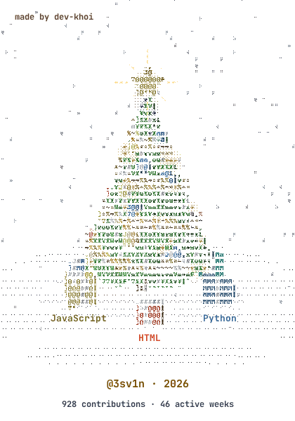

  <picture>
    <source media="(prefers-color-scheme: dark)" srcset="gitmas/tree.gif" />
    <source media="(prefers-color-scheme: light)" srcset="gitmas/tree-light.gif" />
    
  </picture>

 

<i>"Free Software is about freedom, not price." — Richard Stallman</i>

  

  

---

## 👋 About Me

I'm a student and developer who loves turning ideas into working software. I build **full-stack applications**, dig into **data visualization** and **machine learning**, and spend most of my time in **Python**, **web development** and **Flutter**.

I'm a strong advocate for **open source and free software**. Away from the keyboard, you'll find me at the **piano**, playing and occasionally composing music. 🎹

| | |
|---|---|
| 🔭 **Focus** | Full-stack apps, data visualization, machine learning |
| 🧰 **Main stack** | Python · Flutter · Web (React / Next.js / Django) |
| 🌱 **Values** | Open source, free software, sharing what I build |
| 🎶 **Off-duty** | Piano & music composition |

---

## 📦 Open Source Libraries

Published on NPM and actively maintained:

| Package | Version | Downloads |
|:--------|:-------:|:---------:|
| [**@3sv1n/lrc**](https://www.npmjs.com/package/@3sv1n/lrc) |  |  |
| [**@3sv1n/multitrack**](https://www.npmjs.com/package/@3sv1n/multitrack) |  |  |

---

## 📌 Top Projects

  
  
  
  

---

## 💻 Tech Stack

<b>Languages</b>

 

<b>Frameworks & Libraries</b>

 

<b>Tools & Databases</b>

 

---

## 📊 GitHub Stats

  
  

  

---

## 🤝 Let's Connect

I'm always happy to chat about open source, collaborate on projects, or talk music. Reach out through any of the links above, or email me at **[Joshua.Esvin312@gmail.com](mailto:Joshua.Esvin312@gmail.com)**.

   
  
  
<i>Thanks for stopping by! ⭐ Feel free to star anything you find useful.</i>

